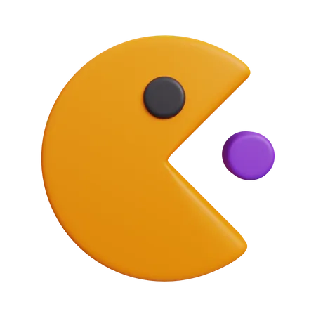

<a id="top"></a>

<div align="center">



<h1>Pac-Man on Pygame</h1>

<p>
  <strong>A Pac-Man recreation in Python with Pygame: eat every pellet and avoid the ghosts.</strong><br />
  <sub>Ghosts, pellets and power pellets in a maze</sub>
</p>

<p>
  <a href="https://voaneves.github.io/pacman-on-pygame/"><picture><source media="(prefers-color-scheme: dark)" srcset="https://raw.githubusercontent.com/voaneves/pacman-on-pygame/master/assets/buttons/landing-dark.svg" /></picture></a>
  <a href="https://github.com/voaneves/pacman-on-pygame/archive/refs/heads/master.zip"><picture><source media="(prefers-color-scheme: dark)" srcset="https://raw.githubusercontent.com/voaneves/pacman-on-pygame/master/assets/buttons/play-dark.svg" /></picture></a>
</p>

<p><sub>Need something like this? <a href="https://voaneves.com/en/#contact"><strong>Let's talk →</strong></a></sub></p>

<p>
  <a href="https://github.com/voaneves/pacman-on-pygame/blob/master/LICENSE"></a>
  
  <a href="https://github.com/voaneves/pacman-on-pygame/issues"></a>
</p>

<p>
  <a href="#about-the-project">About</a> ·
  <a href="#gameplay">Gameplay</a> ·
  <a href="#running-it">Running it</a> ·
  <a href="#contributing">Contributing</a> ·
  <a href="#contact">Contact</a>
</p>

</div>

<picture>
  <source media="(prefers-color-scheme: dark)" srcset="https://raw.githubusercontent.com/voaneves/pacman-on-pygame/master/assets/brand/rule-dark.svg" />
  <source media="(prefers-color-scheme: light)" srcset="https://raw.githubusercontent.com/voaneves/pacman-on-pygame/master/assets/brand/rule-light.svg" />
  
</picture>

## About the project

Play the classic Pac-Man in a Python window: steer through the maze, eat every pellet and keep away from the ghosts.

The project recreates the iconic game with the Pygame library, with the familiar Pac-Man character, ghosts, and a maze filled with pellets. It is built with Python and Pygame.

## Gameplay

The objective is to control Pac-Man, navigate the maze and eat all the pellets while avoiding the ghosts. Use the arrow keys to move Pac-Man. Power pellets temporarily let Pac-Man eat the ghosts.

## Running it

Install the dependencies and start the game from the repository root:

```
$ pip install pygame numpy pandas
$ python pacman.py
```

## Contributing

Contributions are welcome. If you would like to enhance the game or fix an issue:

1. Fork the repository.
2. Create a new branch: `git checkout -b my-branch`.
3. Make your changes and commit them: `git commit -m 'Add some feature'`.
4. Push the changes to your fork: `git push origin my-branch`.
5. Open a pull request and describe the changes you made.

Found a bug or have an idea? Open an [issue](https://github.com/voaneves/pacman-on-pygame/issues).

## Contact

<p>
  <a href="https://voaneves.com/en/#contact"><picture><source media="(prefers-color-scheme: dark)" srcset="https://raw.githubusercontent.com/voaneves/pacman-on-pygame/master/assets/buttons/hire-dark.svg" /></picture></a>
  <a href="https://voaneves.com/en/"><picture><source media="(prefers-color-scheme: dark)" srcset="https://raw.githubusercontent.com/voaneves/pacman-on-pygame/master/assets/buttons/site-dark.svg" /></picture></a>
</p>

<a href="https://linkedin.com/in/voaneves">LinkedIn</a> · <a href="mailto:victorneves478@gmail.com">E-mail</a>

<p align="center">
  
</p>

<p align="center"><sub>Released under the <a href="https://github.com/voaneves/pacman-on-pygame/blob/master/LICENSE">MIT License</a>.</sub></p>

<p align="center"><sub><a href="#top">↑ Back to top</a></sub></p>
